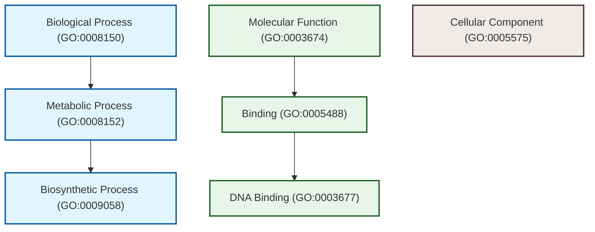
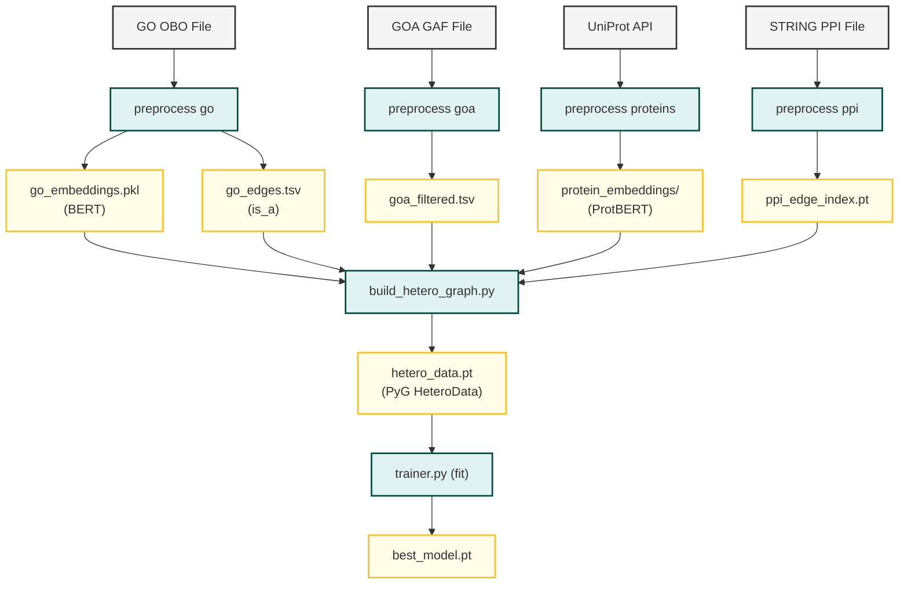
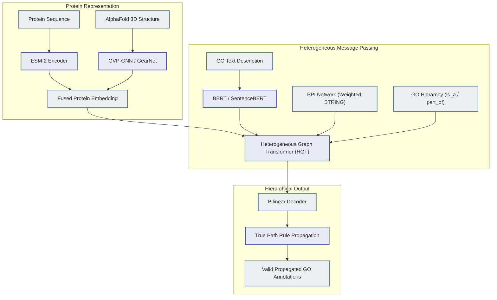

# Technical Report: Project State and Future Directions for Aid2Go

**Author:** Chief Staff Engineer & Molecular Biology Tech Lead  
**Date:** June 22, 2026  
**Project:** Aid2Go (Protein Function Prediction with Heterogeneous GNNs)

---

## 1. Executive Summary

The **Aid2Go** project aims to solve one of the fundamental challenges in computational biology: predicting the biological functions of proteins. Traditional experimental methods to identify protein function (such as wet-lab assays) are slow, labor-intensive, and expensive, leaving a massive gap between the number of sequenced proteins and those with verified functions. 

Aid2Go leverages **Heterogeneous Graph Neural Networks (HeteroGNNs)** to model this task as a link prediction problem on a multi-relational graph. The graph integrates three distinct types of biological information:
1. **Protein Nodes:** Represented by evolutionary and structural information captured via deep sequence language models (**ProtBERT**).
2. **Gene Ontology (GO) Nodes:** Represented by semantic text embeddings (**BERT**) of their official ontological definitions.
3. **Biological Networks:** Capturing interactions between proteins (Protein-Protein Interactions; **PPI**) and hierarchical relationships between functions (GO DAG; **is_a** edges).

By learning joint representations of proteins and functional categories (GO terms), the GNN can "naturally" predict whether a protein is annotated with a specific function based on its neighborhood in the multi-layered graph.

---

## 2. Scientific and Biological Context

Predicting protein function requires a deep understanding of the language of molecular biology and the structure of functional ontologies.

### 2.1 The Gene Ontology (GO) DAG
The Gene Ontology is structured as a **Directed Acyclic Graph (DAG)**. Functions are categorized into three independent namespaces (aspects):
*   **Molecular Function (MFO):** Elemental activities at the molecular level (e.g., *catalytic activity*, *binding*).
*   **Biological Process (BPO):** Broader biological programs accomplished by multiple molecular actions (e.g., *mitosis*, *pyrimidine metabolic process*).
*   **Cellular Component (CCO):** The cellular locations where a protein executes its function (e.g., *mitochondrial matrix*, *ribosome*).

Crucially, the GO hierarchy obeys the **True Path Rule**: if a protein is annotated with a specific term, it is implicitly annotated with all ancestral terms in the DAG (up to the root of that aspect). Conversely, a protein cannot be annotated with a term if it is not annotated with its parent.



### 2.2 Information Accretion (IA)
In the context of the CAFA (Critical Assessment of Functional Annotation) challenge, predicting general terms close to the root (e.g., "binding") is trivial but carries very little scientific value. In contrast, predicting highly specific terms deep in the DAG (e.g., "RNA-directed DNA polymerase activity") is difficult but highly informative.

To quantify this, we compute the **Information Accretion (IA)** of each term $T$. Let $P(T)$ be the set of direct parent terms of $T$ in the ontology. The frequency $f(T)$ is the probability of a protein being annotated with $T$ in a database (like Swiss-Prot). The IA is defined as:
$$IA(T) = -\log_2 \left( \frac{f(T)}{f(P(T))} \right)$$
where $f(P(T))$ is the probability of a protein being annotated with *all* parents of $T$. 
*   **Root terms** have $IA = 0$ (they carry no additional information).
*   **Specific terms** have high $IA$ because they occur rarely relative to their parent terms.

### 2.3 Guilt by Association & PPI Networks
The physical and functional interactions between proteins (PPI) represent pathways, complexes, and signaling cascades. The **guilt-by-association** principle states that proteins that physically interact or participate in the same pathway are likely to share biological functions. Integrating PPI networks as homogeneous edges between protein nodes allows GNNs to propagate functional context across neighboring proteins.

---

## 3. Current Project Architecture

The codebase has recently been refactored into a clean, modular structure. Below is a breakdown of the current package components:

```text
src/aid2go/
├─ core/
│  ├─ config.py       # Pydantic schemas (AppConfig) mapping YAML configs
│  ├─ paths.py        # Centralized project directory resolution (ProjectPaths)
│  ├─ seed.py         # Deterministic seed initialization
│  ├─ types.py        # Shared enums and type aliases
├─ data/
│  ├─ preprocess_go.py        # OBO parsing and GO sentence embeddings (BERT)
│  ├─ preprocess_goa.py       # GAF filtering by evidence codes (experimental/CAFA)
│  ├─ preprocess_proteins.py  # Sequence fetching (UniProt) & ProtBERT embedding
│  ├─ preprocess_ppi.py       # (Draft) PPI index extraction
│  ├─ build_hetero_graph.py   # Canonical assembler of HeteroData object
│  └─ splits.py               # Link prediction splitter (RandomLinkSplit)
├─ modeling/
│  ├─ baseline_model.py       # GraphSAGE encoder + Dot Product link predictor
│  ├─ smart_model.py          # GATConv encoder + Dot Product link predictor
│  ├─ losses.py               # BCE and Focal Loss for handling annotation sparsity
│  └─ registry.py             # Model registry pattern
├─ training/
│  ├─ trainer.py              # PyG LinkNeighborLoader training loop with checkpointing
│  └─ mlflow_tracker.py       # MLflow experiment tracker integration
└─ cli/
   ├─ app.py                  # Main Typer entrypoint
   ├─ preprocess_cmd.py       # CLI commands for data pipeline stages
   └─ train_cmd.py            # CLI commands for training
```

### 3.1 Data Flow Chart
The diagram below describes how data flows from raw databases to the final trained GNN models.



### 3.2 GNN Modeling Details
The models formulate protein-GO binding as a link prediction task. Given the HeteroData graph with node sets $\mathcal{V}_p$ (proteins) and $\mathcal{V}_g$ (GO terms):
1.  **Node Encoders:**
    *   Proteins are initialized with features $X_p \in \mathbb{R}^{|\mathcal{V}_p| \times 1024}$ (ProtBERT features).
    *   GO terms are initialized with features $X_g \in \mathbb{R}^{|\mathcal{V}_g| \times 768}$ (BERT features).
    *   A linear projection layers map them to a shared latent size $d$ (typically 128).
2.  **Message Passing:**
    *   **Baseline:** Uses `to_hetero` to apply GraphSAGE (`SAGEConv`) across the multi-relational graph:
        *   `("protein", "interacts", "protein")`
        *   `("go", "is_a", "go")`
        *   `("protein", "has_function", "go")` and its reverse.
    *   **Smart:** Uses GAT (`GATConv`) with multi-head attention to dynamically compute attention weights between connected nodes.
3.  **Link Prediction Decoder:**
    *   Given a pair $(v_p, v_g)$, the model computes final embeddings $z_p$ and $z_g$.
    *   The link probability logit is predicted via dot product: $\hat{y}_{pg} = z_p \cdot z_g$.
4.  **Handling Sparse Labels (Imbalance):**
    *   Because the number of annotated links is extremely small relative to all possible protein-GO pairs, positive links are sparse.
    *   The baseline uses a 1:1 negative sampling ratio with standard BCE loss.
    *   The "Smart" option implements **Focal Loss** to down-weight easy negative examples:
        $$\mathcal{L}_{\text{Focal}} = -\alpha (1 - p_t)^\gamma \log(p_t)$$
        where $p_t$ is the model's confidence in the true label.

---

## 4. Current Gaps and Technical Debt

While the structure of `src/aid2go` is very clean, there are several key gaps when compared with the exploratory codebase in `code_to_use_for_refactor` and production-grade scientific pipelines:

1.  **Unfleshed-out CLI Commands:**
    *   `aid2go explain` is a stub ("Explainability not yet implemented").
    *   `aid2go preprocess ppi` writes an empty tensor placeholder, failing to ingest real PPI datasets (e.g., STRING DB) and filter them by confidence threshold as defined in the config.
    *   `aid2go predict` operates on a skeleton `predict_all` returning raw encoder tensors, lacking link decoder resolution and top-k term extraction.
2.  **Missing Scientific Analyses from Legacy Code:**
    *   The legacy script `go.py` contains HDBSCAN, Spectral Embedding, UMAP, and t-SNE grid search clustering on GO representations. None of this is integrated into the package's `eda` command (which only computes basic node degrees).
    *   **Information Accretion (IA)** computation in `ia.py` is fully implemented in the legacy folder but completely bypassed in the current data pipeline. It is not computed during preprocessing, not attached as an attribute to GO nodes, and not used during model training or evaluation.
3.  **Basic Evaluation Metrics Mismatch:**
    *   The current `cafa_evaluator.py` calculates flat, flattened AUPR and Fmax over link prediction tensors. 
    *   In real-world protein function prediction, the metrics must account for:
        *   **Ontology propagation (True Path Rule):** If a term is predicted, parent terms must be updated.
        *   **Protein-centric metrics:** Precision and recall must be calculated per protein, then averaged (micro/macro), rather than flattening the entire validation batch.
4.  **Inefficient Data Loading:**
    *   `build_hetero_graph.py` loads protein sequence embeddings by doing `torch.load` in a loop for each protein file. For a genome-scale dataset with tens of thousands of proteins, this causes high disk I/O bottlenecks and memory overflows during graph construction.

---

## 5. Strategic Roadmap and Future Directions

To transition Aid2Go into a state-of-the-art scientific tool, we propose the following improvements across three dimensions: Biology, Architecture, and Engineering.

### 5.1 Biological & Scientific Improvements

#### 5.1.1 True-Path Hierarchy Constraints
*   **The Issue:** The current dot-product decoder can predict high probability for a specific term (e.g., "DNA binding") but low probability for its parent ("binding"). This violates the ontology.
*   **Solution:** Implement hierarchy-aware inference or regularization. We can post-process scores using the True Path Rule:
    $$S_i = \max_{j \in \text{descendants}(i)} p_j$$
    Alternatively, we can design a hierarchical loss penalty that penalizes violations where $p_{\text{child}} > p_{\text{parent}}$.

#### 5.1.2 Integration of Information Accretion (IA)
*   **The Issue:** The GNN treats all annotations equally.
*   **Solution:** Ingest `ia.tsv` during preprocessing and attach it to the GO nodes as node features or edge weights:
    *   Use $IA$ to scale the binary cross-entropy loss (paying higher penalty for misclassifying specific terms).
    *   Use $IA$ during evaluation to calculate **weighted Fmax** (Smin metric), rewarding predictions of highly specific functional terms.

#### 5.1.3 Upgrade to Advanced Language Models (ESM-2 / ESM-3)
*   **The Issue:** ProtBERT is a legacy transformer model.
*   **Solution:** Replace the protein encoder embeddings with **ESM-2 (Evolutionary Scale Modeling)** representation (e.g., `esm2_t33_650M_UR50D`). ESM-2 embeddings contain significantly richer evolutionary, structural, and functional representations.

#### 5.1.4 Leverage 3D Structure Data (Structure-GNNs)
*   **The Issue:** Sequence representations ignore the 3D fold of the protein, which determines ligand binding pockets and active sites.
*   **Solution:** 
    *   Download AlphaFold structures (.pdb) for target proteins.
    *   Represent protein nodes themselves as graphs (amino acids as nodes, 3D spatial contacts as edges).
    *   Use structural GNNs (like **GearNet** or **GVP-GNN**) to encode proteins before feeding them into the heterogeneous protein-GO graph.

---

### 5.2 GNN Architecture Advancements



#### 5.2.1 Heterogeneous Graph Transformer (HGT)
*   Instead of using standard GAT or SAGE mapped to hetero via `to_hetero`, implement a dedicated **Heterogeneous Graph Transformer (HGT)**. HGT uses relation-specific attention parameters, allowing the network to distinguish how a protein interacts with another protein (PPI) vs how a protein binds to a GO term (GOA).

#### 5.2.2 Bilinear Decoder with Aspect Subgraphs
*   Replace the simple dot product decoder with a bilinear projection matrix $W_r$:
    $$\hat{y}_{pg} = z_p^T W z_g$$
    This models the complex asymmetric relationships between proteins and functional terms. Furthermore, we should train three separate decoders (or branches) for the three namespaces (MFO, BPO, CCO) since their topology and biological distribution differ drastically.

---

### 5.3 Technical & Engineering Optimization

#### 5.3.1 Graph Explainability (XAI)
*   **Technical Implementation:** Implement the `explain` command using **GAT Attention Rollout** or **Integrated Gradients** via PyG's `Explainer`. 
*   **User Interface:** For any predicted link $(v_p, v_g)$, the explainer should output:
    1.  A localized subgraph containing the protein, the target GO term, and the most heavily weighted neighboring proteins (from PPI) or parent GO terms (from DAG).
    2.  An attribution score for each node and edge contributing to the prediction.
    3.  A visualization using NetworkX and HTML to render the explanation subgraph for computational biologists to review.

#### 5.3.2 Memory Mapping & Lazy Loading for Scale
*   To scale to larger datasets, we must move away from loading all protein `.pt` files individually into memory.
*   **Solution:** Pre-save all protein embeddings into a single **Zarr** or **HDF5** array. During GNN data loading, the GNN loader can lazily retrieve slices of this tensor using coordinate indices, reducing disk I/O and peak RAM usage by orders of magnitude.

#### 5.3.3 CAFA Submission Output formatting
*   Build an export pipeline that takes predicted probabilities, performs aspect-specific normalization, applies True Path Rule propagation, and exports a text file matching the CAFA format:
    ```text
    <Protein_ID>    <GO_Term>    <Probability>
    P12345          GO:0003677   0.85
    P12345          GO:0005488   0.92
    ```
    This bridges the gap between raw model outputs and scientific benchmarks.
