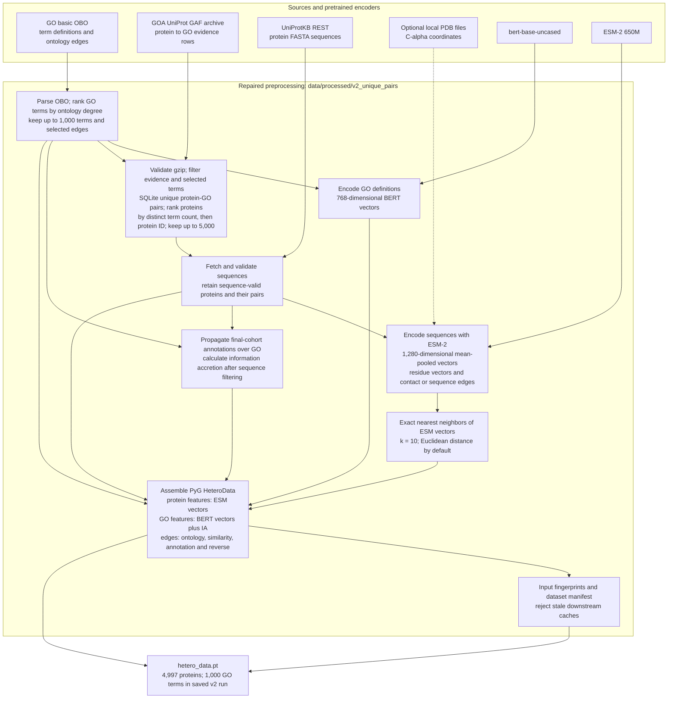
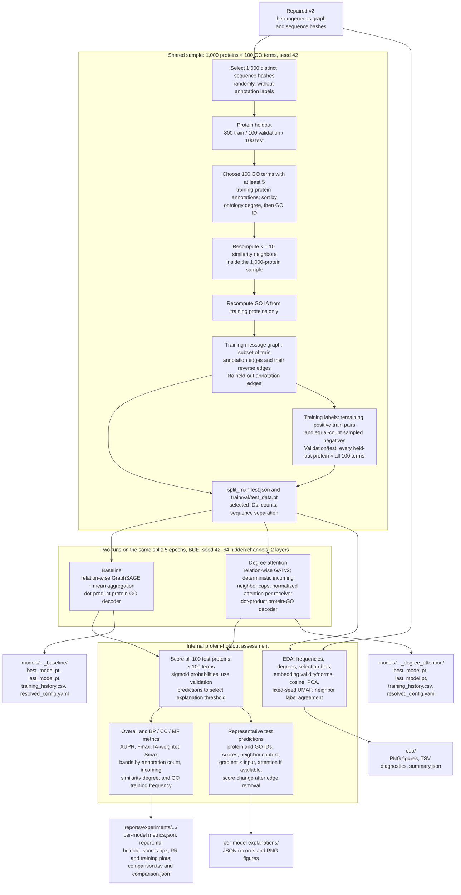

# Aid2Go pipeline and model inspection map

These diagrams describe the implemented `v2_unique_pairs` pipeline and the saved
`1,000 × 100`, seed 42 comparison. Arrows show data dependencies. The legacy
`v1` artifacts remain separate.

## 1. Sources to the repaired heterogeneous graph

The main artifacts are `go_nodes.csv`, `go_edges.tsv`, `go_embeddings.pkl`,
`goa_filtered.tsv`, `protein_sequences.tsv`, `sequence_hashes.tsv`,
`protein_data.h5`, `ia_values.tsv`, `ppi_edge_index.pt`, and `hetero_data.pt`.
The repair audit reports 39,575 unique annotation pairs in the saved v2 graph.
In graph assembly, selected ontology edges are stored under the PyG relation
name `is_a`; the input edge table also records each original relationship.
Optional PDB coordinates are read from local files; this preprocessing path does
not fetch structures.

## 2. Shared sample to training, evaluation, and saved outputs

The held-out annotation and reverse edges are absent from message passing.
Validation and test message graphs include the sampled similarity edges, so a
held-out protein can receive sequence-neighbor context. Attention weights and
edge-removal score changes are model diagnostics, not biological causal evidence.
Observed annotations are incomplete; an unobserved pair is not a proven
nonfunction. These are **internal protein-holdout results, not a CAFA benchmark**.

### Open the implementation and results

| Inspect | Code or saved output |
|---|---|
| GO, GOA, protein, and graph preparation | [`preprocess_go.py`](../src/aid2go/data/preprocess_go.py), [`preprocess_goa.py`](../src/aid2go/data/preprocess_goa.py), [`preprocess_proteins.py`](../src/aid2go/data/preprocess_proteins.py), [`build_hetero_graph.py`](../src/aid2go/data/build_hetero_graph.py) |
| Sample and split logic | [`sample.py`](../src/aid2go/data/sample.py), [`split_manifest.json`](../data/processed/v2_unique_pairs_sample_1000x100_seed42/split_manifest.json) |
| Model layers and training | [`baseline_model.py`](../src/aid2go/modeling/baseline_model.py), [`degree_attention.py`](../src/aid2go/modeling/degree_attention.py), [`trainer.py`](../src/aid2go/training/trainer.py) |
| Evaluation and explanations | [`protein_holdout.py`](../src/aid2go/eval/protein_holdout.py), [`explain/report.py`](../src/aid2go/explain/report.py) |
| Comparison | [`comparison.tsv`](../reports/experiments/v2_unique_pairs_sample_1000x100_seed42/comparison.tsv), [`comparison.json`](../reports/experiments/v2_unique_pairs_sample_1000x100_seed42/comparison.json) |
| Per-model metrics | [baseline](../reports/experiments/v2_unique_pairs_sample_1000x100_seed42/baseline/metrics.json), [degree attention](../reports/experiments/v2_unique_pairs_sample_1000x100_seed42/degree_attention/metrics.json) |
| EDA index | [`summary.json`](../reports/experiments/v2_unique_pairs_sample_1000x100_seed42/eda/summary.json) |
| Saved configs | [baseline](../models/v2_unique_pairs_sample_1000x100_seed42_baseline/resolved_config.yaml), [degree attention](../models/v2_unique_pairs_sample_1000x100_seed42_degree_attention/resolved_config.yaml) |

For the saved test set, baseline AUPR/Fmax/Smax were
`0.2927 / 0.4022 / 2.9913`; degree attention yielded
`0.2850 / 0.3286 / 3.1266`. The detailed reports contain the aspect-specific
and stratified results. These numbers describe this single fixed-seed run.

The ordinary `aid2go pipeline --config configs/default.yaml` keeps the
5,000-protein/1,000-term limits and the existing **link-holdout** route. It runs
preprocessing, EDA, training, evaluation, and true-path-adjusted prediction
export. The controlled comparison above is produced by
`aid2go experiment sample --baseline-config configs/default.yaml --attention-config configs/degree_attention.yaml --proteins 1000 --go-terms 100 --seed 42`.
